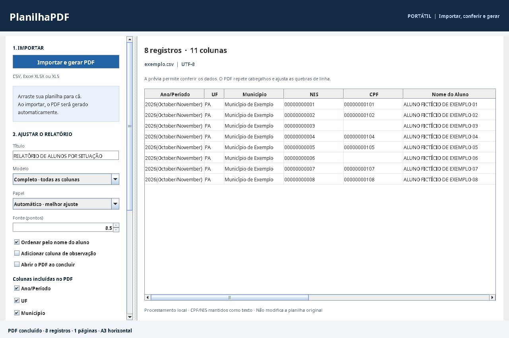
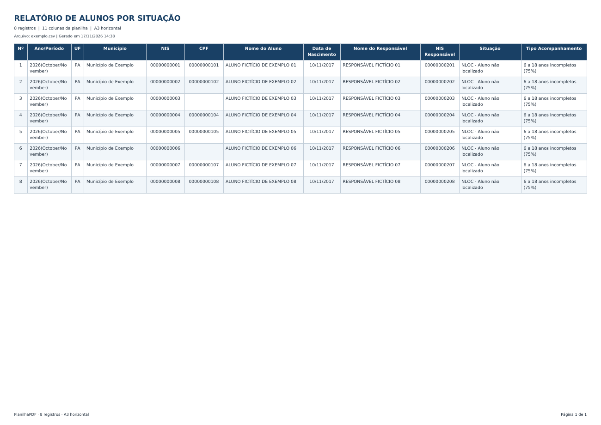

# PlanilhaPDF Portátil

Aplicativo Java de desktop para **importar uma planilha e gerar automaticamente um PDF com colunas ajustadas**. Desenvolvido a partir de um CSV de alunos por situação e de um PDF de conferência fornecidos pelo solicitante.

## Baixar e executar no pendrive

**[Baixar o pacote Windows x64, com Java incluído](https://github.com/marcoalexandreti/SISTEMAS/raw/refs/heads/main/planilha-pdf-portatil/PlanilhaPDF_Portatil_Windows_x64.zip)**

1. Extraia **todo o ZIP** para o pendrive ou uma pasta do computador.
2. Abra **`Iniciar.bat`**.
3. Clique em **Importar e gerar PDF** e escolha o arquivo.
4. O PDF é criado automaticamente em **`Relatorios`**, junto do programa.

Não é necessário instalar Java, Maven ou bibliotecas. A pasta `runtime` acompanha o programa e precisa permanecer junto do JAR. Não execute diretamente de dentro do ZIP. Requisitos: **Windows 10/11 de 64 bits**, aproximadamente 300 MB livres para acomodar ZIP/extração, pasta de destino gravável e um leitor de PDF se desejar abrir automaticamente.

O aplicativo trabalha localmente, sem servidor, banco de dados ou envio das planilhas pela internet. Os exemplos incluídos são fictícios. Os CSVs e PDFs reais do solicitante **não são publicados**.



## Ajuste das colunas

- **Completo:** inclui todas as colunas da planilha.
- **Conferência:** organiza Nome do Aluno, NIS, CPF, Data de Nascimento, Nome do Responsável, NIS Responsável e Tipo Acompanhamento, com coluna de Observação. Segue a organização do PDF de referência.
- **Automático:** seleciona A3 horizontal a partir de dez colunas da planilha; nos demais casos usa A4 horizontal.
- É possível selecionar **A4 horizontal** mesmo com todas as colunas. O programa conserva os campos e distribui o conteúdo em mais linhas e páginas quando necessário.
- O usuário pode escolher colunas, tamanho de fonte entre 7 e 12 pontos, título, ordenação e pasta de saída.
- Cabeçalhos são repetidos em todas as páginas; há numeração e total de registros.
- Textos longos quebram em linhas. Linhas excepcionalmente extensas continuam na página seguinte, sem truncamento deliberado.
- A prévia tem rolagem horizontal para consultar todas as colunas.



## Formatos e preservação de dados

Suporta **CSV, TSV, XLSX e XLS**. CSV detecta ponto e vírgula, vírgula ou tabulação; reconhece UTF-8, UTF-16 com BOM e Windows-1252. Para o relatório de alunos, identifica a linha `Nome do Aluno` e ignora o preâmbulo do arquivo.

CPF e NIS são mantidos como texto; os campos vazios continuam vazios. Datas do CSV são preservadas, e datas numéricas reconhecidas no Excel são exibidas com ano completo. Zeros que já foram perdidos no arquivo original não podem ser recuperados por adivinhação. Não há validação de CPF/NIS nem alteração dos identificadores.

No Excel, lê a primeira aba visível com dados e usa os valores de fórmulas já salvos no arquivo. Salve os cálculos atualizados no Excel antes da importação. Macros não são executadas.

Limites operacionais: 80 MB por arquivo, 100 mil linhas e até 18 colunas selecionadas por PDF. O conteúdo não é convertido em uma matriz com alunos nas colunas: os alunos permanecem nas linhas, preservando a estrutura de tabela do relatório de referência.

## Validação

- **13 testes automatizados passaram**, cobrindo CSV/Excel, aspas, acentos, zeros, datas, campos vazios, paginação, linhas longas e limites de página.
- Teste gráfico em Linux: importação, geração automática, prévia, mudança para conferência e seleção de A4 passaram.
- O CSV real foi validado localmente com **95 registros e 11 colunas**. O total de 141 do PDF de referência não foi reaproveitado.
- Completo automático: **5 páginas A3 horizontais**.
- Conferência: **8 páginas A4 horizontais**.
- A comparação por coluna nesses dois PDFs não encontrou campos/ocorrências ausentes nem palavras fora das margens.
- Runtime Windows: **Eclipse Temurin 21.0.13+9**, baixado da distribuição oficial e com SHA-256 conferido.

**A execução nativa em Windows ainda precisa ser validada no computador de destino.** A lógica, a interface Swing e a geração de PDF foram testadas em Linux. O pacote Windows inclui seu runtime, mas não é um instalador nem possui um executável próprio assinado.

Os arquivos em `validacao/` apresentam resultados sem expor os alunos reais.

## Uso por linha de comando

Com o Java incluído no pacote Windows:

```bat
runtime\bin\java.exe -jar PlanilhaPDF.jar --gerar "arquivo.csv"
```

Destino, modelo e papel explícitos:

```bat
runtime\bin\java.exe -jar PlanilhaPDF.jar --gerar "arquivo.csv" --saida "Relatorios\alunos.pdf" --modelo conferencia --papel A4
```

Sem `--saida`, gera um nome com data e hora na pasta `Relatorios`. Com `--saida`, o caminho é explícito e um PDF existente nesse caminho pode ser substituído.

## Compilar o código-fonte

Requer **JDK 21 e Maven 3.9+**:

```text
mvn clean package
```

O JAR com bibliotecas fica em `target/PlanilhaPDF.jar`. Para abrir em uma sessão gráfica:

```text
java -jar target/PlanilhaPDF.jar
```

Bibliotecas principais: Apache PDFBox 3.0.8, Apache POI 6.0.0 e Apache Commons CSV 1.14.1. Os PDFs incorporam fontes DejaVu. Licenças e avisos das dependências são preservados no pacote, e a licença do Java está em `runtime/legal`.
