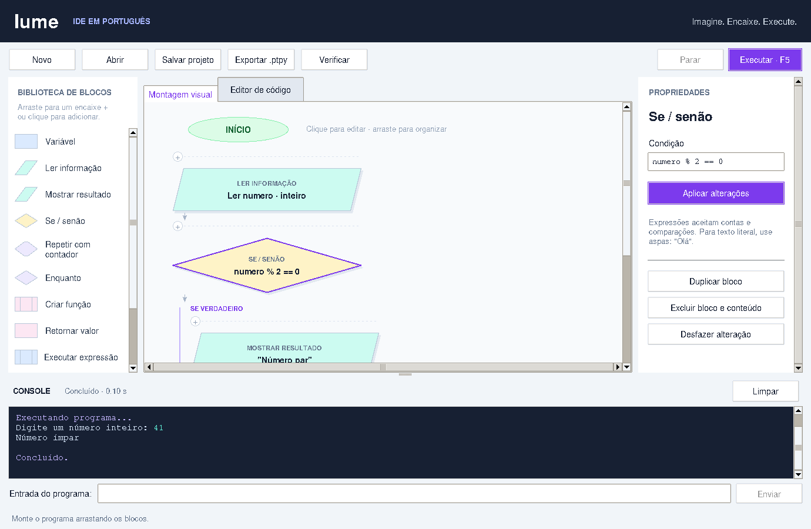
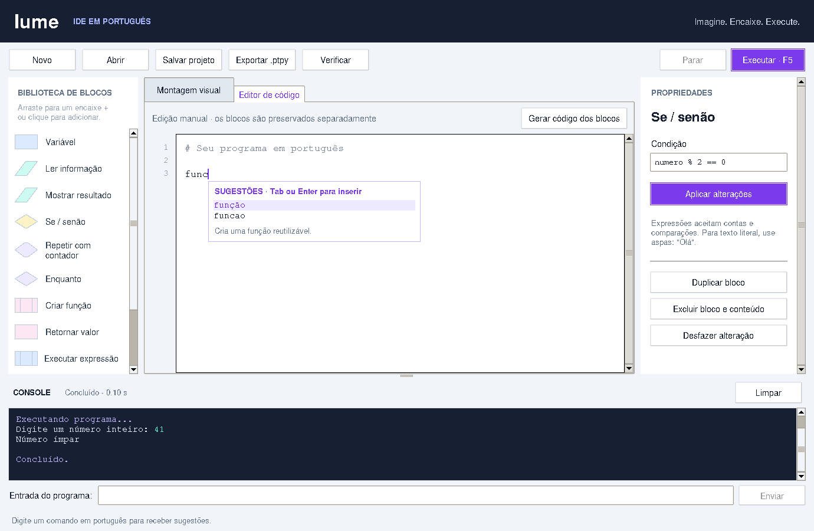

# Lume IDE — programe em português

IDE de desktop com **editor que sugere comandos e funções**, montagem de programas com **formas geométricas arrastáveis** e console com entrada de dados.

## Começar no Windows

1. [Baixe o ZIP da IDE](https://github.com/marcoalexandreti/SISTEMAS/raw/refs/heads/main/python-portugues/Lume_IDE_Portugues.zip).
2. Extraia **todos os arquivos** para uma pasta.
3. Tenha [Python 3.12 ou superior](https://www.python.org/downloads/windows/) instalado, incluindo o componente Tcl/Tk do instalador oficial.
4. Abra `iniciar_ide.bat` dentro da pasta extraída.

Também é possível abrir pelo terminal:

```bat
py -3 ide.py
```

Não é necessário instalar pacotes por pip nem compilar o interpretador para experimentar a IDE. O ZIP contém o aplicativo em Python, **não um EXE independente**.

No Linux, use `python3 ide.py`, com Tkinter e uma sessão gráfica disponíveis.

## Montagem visual



1. Abra **Exemplos → Par ou ímpar com entrada**, ou crie um projeto novo.
2. Arraste uma forma da biblioteca para uma linha com **+**. A linha roxa indica o encaixe escolhido.
3. Clique no bloco e preencha o painel **Propriedades**.
4. Clique em **Aplicar alterações** ou pressione Enter no campo.
5. Encaixe instruções no caminho **Se verdadeiro**, no caminho **Senão**, dentro de uma repetição ou no corpo de uma função.
6. Arraste um bloco existente para mudar sua posição. Seu conteúdo aninhado acompanha o bloco.
7. Clique em **Executar** ou pressione **F5**.

Um clique simples na biblioteca adiciona o bloco ao final do programa. Para escolher um ramo ou outra posição, arraste até o encaixe. Use a rolagem da área visual para alcançar as partes inferiores; arrastar perto da borda também ajuda a rolar.

| Forma | Significado |
|---|---|
| Oval | Início e fim, desenhados automaticamente |
| Retângulo | Variável ou operação |
| Paralelogramo | Entrada ou saída de dados |
| Losango | Decisão ou teste de repetição |
| Hexágono | Repetição com contador |
| Retângulo com linhas laterais | Definição ou chamada de função |
| Nota | Comentário |

O diagrama é uma montagem estruturada de blocos. Os ramos são apresentados com rótulos e recuo, e não como um fluxograma livre com ligações arbitrárias.

### Como preencher os campos

- **Nome:** use identificadores como `idade`, `total` ou `resultado`, sem espaços.
- **Valor ou expressão:** use `2`, `a + b` ou `"Marcos"`. Textos literais precisam de aspas.
- **O que mostrar:** aceita `"Olá"`, `resultado` ou `"Resultado:", resultado`.
- **Condição:** aceita `idade >= 18`, `numero % 2 == 0` e combinações com `e`, `ou`, `não`.
- **Entrada:** a pergunta é texto comum, sem precisar escrever aspas. Escolha `inteiro`, `real` ou `texto`.
- **Repetição:** o limite final não é incluído. Para mostrar 1 até 5, use início 1, fim 6 e passo 1.
- **Função:** informe nome e parâmetros separados por vírgulas. Coloque Retornar valor dentro dela. Para chamar, use Executar expressão, por exemplo `escreva(somar(2, 3))`.

## Editor e sugestões



- Comece a digitar `escr`, `func`, `para` ou outro comando para ver sugestões e explicações.
- **Ctrl+Espaço** abre a lista de sugestões.
- **Setas** escolhem uma sugestão; **Tab ou Enter** insere; **Esc** fecha.
- Estruturas como `se` e `função` inserem um esqueleto e selecionam o campo que precisa ser preenchido.
- Enter conserva o recuo e adiciona quatro espaços depois de dois-pontos.
- Tab sem sugestões insere quatro espaços; Shift+Tab remove até quatro espaços no início da linha.
- **Ctrl+F** busca e destaca ocorrências.

As sugestões cobrem o vocabulário português e funções básicas conhecidas. Não há análise completa de tipos nem descoberta automática de todas as funções de bibliotecas externas.

O código dos blocos aparece na aba de edição. Se você modificar o texto manualmente, a IDE **mantém os blocos separados**. Mudanças no diagrama não apagam seu texto. **Gerar código dos blocos** pede confirmação antes de substituir a edição manual.

Não há conversão automática de código digitado para blocos.

## Executar e responder ao programa

- Na aba visual, F5 executa o programa gerado dos blocos.
- Na aba de código, F5 executa o texto atual do editor.
- Se houver `leia`, digite a resposta em **Entrada do programa**, abaixo do console, e pressione Enter ou Enviar.
- **Parar** ou **Shift+F5** interrompe o processo do programa. A IDE continua aberta.
- **Verificar** confere a estrutura e a sintaxe, mas não garante ausência de erros de execução.

A execução acontece em um processo separado. Ela usa os recursos e permissões normais do usuário; não é uma máquina virtual isolada.

Por padrão, o executor compatível traduz os tokens da sintaxe portuguesa e executa com o Python instalado. Strings e comentários não são traduzidos. Os números de linha são preservados; colunas e detalhes dos diagnósticos podem diferir do interpretador nativo.

Se já compilou o CPython português, abra **Interpretador**, selecione seu `python.exe` e salve. Nesse modo, o próprio parser nativo compila os arquivos `.ptpy`. O executor fornece os nomes auxiliares e as mesmas rotinas de console.

Arquivos temporários são usados para executar o texto atual. O diretório de trabalho é a pasta do projeto salvo; em projetos novos é a pasta da IDE. Salve o projeto antes de trabalhar com arquivos relativos à sua pasta.

### Matemática em português

O módulo auxiliar `matematica` está incluído:

```python
importe matematica como m

escreva(m.raiz_quadrada(25))
escreva(m.fatorial(5))
escreva(m.pi)
```

Ele oferece, entre outras, `seno`, `cosseno`, `tangente`, `piso`, `teto`, `logaritmo`, `graus`, `radianos` e `euler`. As funções trigonométricas recebem radianos.

## Salvar e compartilhar

- **Salvar projeto / Ctrl+S:** grava `.lume.json`, preservando blocos, campos e texto do editor. Reabra com Abrir.
- **Exportar .ptpy:** exporta apenas o programa da aba ativa. Não preserva a montagem visual.
- **Abrir:** aceita projetos `.json` ou código `.ptpy`/`.py`. Abrir código não cria um diagrama automaticamente.
- Para executar um `.ptpy` fora da IDE sem o interpretador nativo: `py -3 executor.py programa.ptpy`.

Exemplos de projetos e código estão na pasta `exemplos/`.

## Verificações realizadas

Foram executados **34 testes**, todos com sucesso em Linux com uma tela virtual, incluindo:

- Arrastar blocos da biblioteca, reordenar e encaixar dentro de uma condição.
- Aceitar uma sugestão com Tab.
- Salvar e reabrir blocos e edição manual.
- Executar um programa que solicita entrada e mostra a resposta.
- Parar uma repetição infinita.
- Gerar e executar condições, funções e repetições aninhadas.
- Executar pelo CPython português compilado anteriormente.

Logs em `testes/resultado_linux.txt`. A interface **ainda não foi validada em Windows**; o iniciador e os caminhos de execução foram preparados para esse sistema.

Para rodar os testes:

```bat
py -3 -m unittest discover -s testes -v
```

O teste de integração nativa usa a variável opcional `LUME_PYTHON_NATIVO` apontando para o interpretador compilado. Sem ela, esse teste é ignorado. Os testes de interface precisam de uma sessão gráfica.

## Arquivos principais

`ide.py` contém a aplicação; `diagrama.py`, a interação visual; `editor.py`, a edição e as sugestões; `blocos.py`, o modelo e a geração de código; `executor.py`, a execução compatível e nativa. A interface usa somente a biblioteca padrão do Python.
